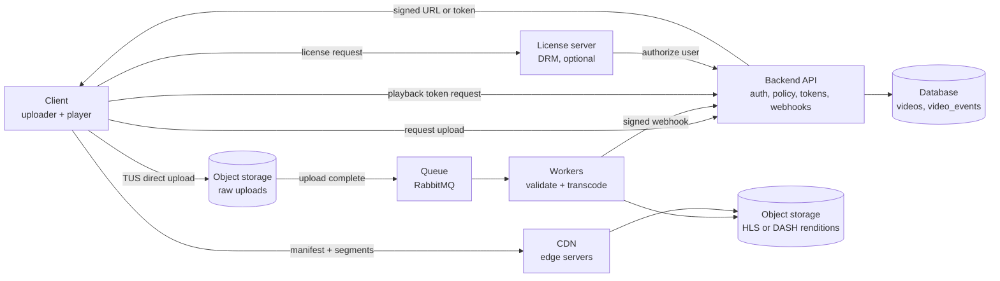
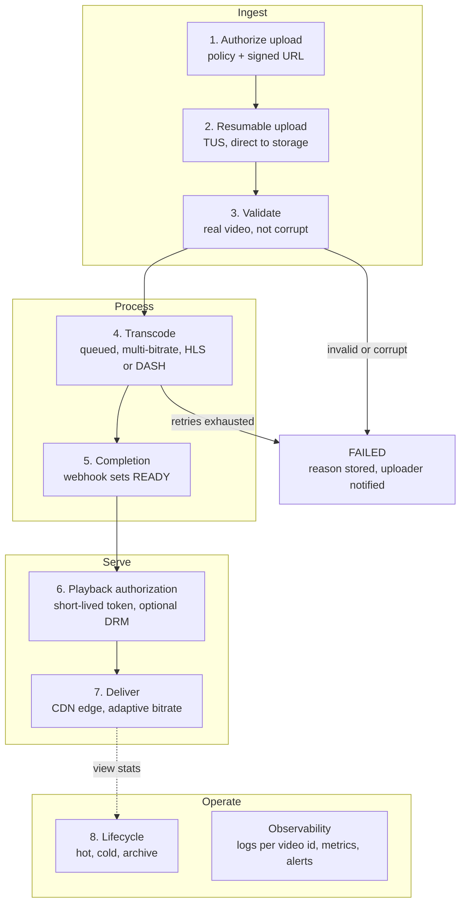
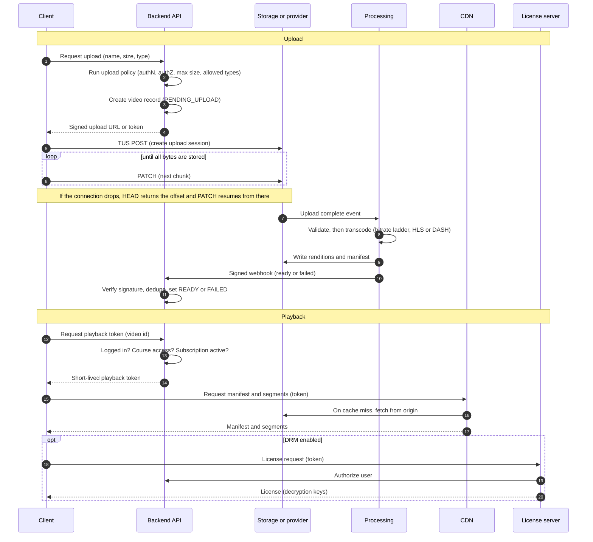
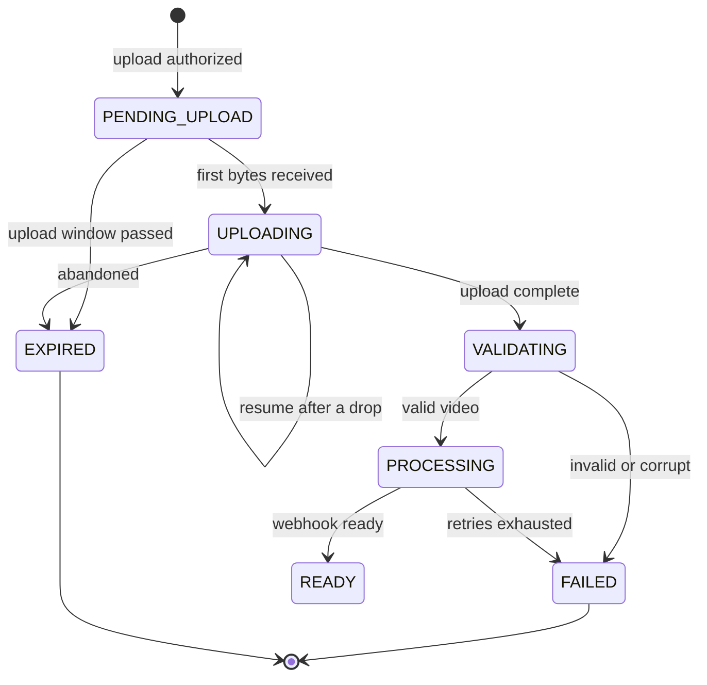
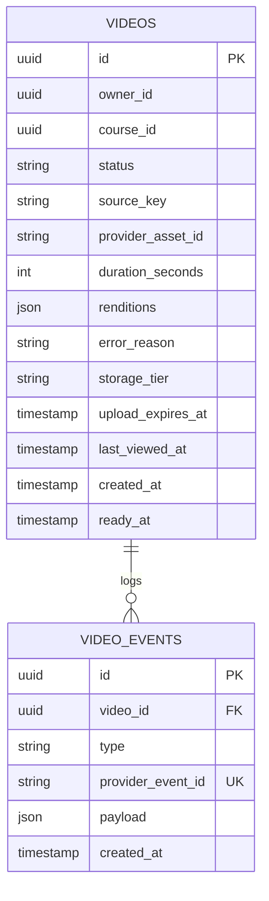

# Video upload and streaming platform: system design

> Source: the OneNote notes in `SD_video_uploader.pdf`. The core flow comes straight from those notes; Appendix B lists what was added beyond them. Diagrams are Mermaid blocks, which GitHub, GitLab and Obsidian render natively.

## 1. Overview

A platform where authorized users upload large videos (multi-GB) and subscribed viewers stream them with adaptive quality. Playback is allowed only if the viewer is logged in, has access to the course that contains the video, and has an active subscription.

**Core rule:** video bytes never pass through the application server. The backend makes decisions (who may upload, who may watch). Object storage, the processing pipeline, and the CDN move the bytes.

## 2. Design principles (from the notes)

1. No uploads to application-server storage: it forces scaling and ever-growing disks. Use object storage (AWS S3, Azure Blob Storage).
2. Video needs streaming, transcoding, a CDN, and security. Use a specialized provider (Cloudflare Stream, Bunny Stream) or write your own pipeline.
3. Uploads do not pass through the backend, because that costs bandwidth, connections, and resources. The backend grants permission and issues a signed upload URL or token. The client then uploads directly to the storage provider.
4. Uploads are resumable (TUS), so a 3 GB upload that drops at 90% does not restart from zero.
5. Processing is asynchronous, through a queue such as RabbitMQ.
6. Playback tokens are very short-lived. DRM adds stronger protection on top.
7. Storage tiers follow how often a video is watched.
8. Every video id has its own logs.

## 3. Architecture at a glance

With a managed provider (Cloudflare Stream, Bunny Stream), the storage, queue, workers, CDN, and license boxes collapse into the provider. The backend keeps the control path: authorize, webhook, playback token.

| Component | Role |
|---|---|
| Client | Uploader (TUS client) and player (HLS or DASH, adaptive bitrate) |
| Backend API | Authentication, upload policy, signed URLs, video state, webhooks, playback tokens |
| Database | Video records and an append-only event log |
| Object storage or provider | Raw uploads and processed renditions |
| Queue and workers | Validation and transcoding in an own-pipeline setup |
| CDN | Edge delivery of manifests and segments |
| License server | DRM licenses (optional) |
| Observability stack | Logs, metrics, alerts across every phase |

## 4. Operation process: eight phases

The phases are in runtime order. Playback authorization (notes page "Security") comes before delivery (notes page "Content Delivery Network") because a viewer's play action triggers them in that order.

Text version: 1 Authorize upload → 2 Resumable upload → 3 Validate → 4 Transcode → 5 Completion → 6 Playback authorization → 7 Deliver → 8 Lifecycle, with observability across all phases.

| Phase | Owner | Result |
|---|---|---|
| 1 Authorize upload | Backend | Video record `PENDING_UPLOAD` and a signed upload URL or token |
| 2 Resumable upload | Client and storage | Raw video object |
| 3 Validate | Worker | Verified source file |
| 4 Transcode | Worker or provider | Renditions plus manifest |
| 5 Completion | Backend | Video marked `READY` |
| 6 Playback authorization | Backend (and license server) | Short-lived playback token |
| 7 Deliver | CDN | Segments from the nearest edge |
| 8 Lifecycle | Storage policies | Video in the right tier |

## 5. Phase details

### Phase 1: Authorize upload

- The frontend asks the backend for upload permission, sending the declared file name, size, and type.
- The backend applies the upload policy: authentication, authorization, max file size, allowed types.
- If granted, the backend creates the `videos` record (`PENDING_UPLOAD`, with an upload expiry) and generates a signed upload URL or upload token limited by size, type, and expiry. The backend chooses the storage key, never the client.
- Declared size and type come from the client, so enforce them at the storage or provider layer and re-verify in Phase 3.

### Phase 2: Resumable upload (TUS)

- Why: a 3 GB video that loses its connection at 90% must not restart.
- Protocol: `POST` creates the upload session, `PATCH` uploads data chunks, `HEAD` asks where the upload stopped.
- The client keeps the upload URL so a refresh or reconnect resumes from the last offset.
- TUS endpoint options: the provider's endpoint, or a self-hosted server (for example `tusd`) writing to object storage.
- Abandoned sessions expire (TUS expiration, or a storage lifecycle rule for incomplete uploads). The video then moves to `EXPIRED`.

### Phase 3: Validate

- Real video file: probe the container and streams (for example with `ffprobe`) instead of trusting the extension or MIME type.
- Not corrupted: the probe succeeds, a video stream exists, duration is greater than zero.
- Re-check size and duration limits.
- Run validation in isolated, resource-limited workers, because the input is untrusted.
- On failure: `FAILED` with a reason code, notify the uploader, delete or quarantine the raw object.

### Phase 4: Transcode

- Asynchronous, through a queue such as RabbitMQ. The job message carries the video id, the source key, and the target ladder.
- Multi-bitrate encoding produces renditions such as 240p, 360p, 720p, and above.
- Output is HLS or DASH segments plus a manifest (`.m3u8` for HLS, `.mpd` for DASH). The manifest tells the player which qualities exist, which enables adaptive bitrate streaming: in auto mode the player switches quality based on network speed.
- Reliability: acknowledge a job only after its output is written, retry with backoff, send exhausted jobs to a dead-letter queue, and key jobs by video id so redelivery is harmless.
- Scale workers on queue depth.
- With a managed provider this phase runs inside the provider and the backend waits for the webhook.
- With DRM enabled, package encrypted HLS or DASH. Keys are held by the license service.

### Phase 5: Completion (webhook)

- The backend learns that processing finished through a webhook.
- Verify the signature, dedupe by event id, and answer 2xx quickly.
- Set `READY` (store duration, renditions, manifest reference) or `FAILED` (store the reason).
- A reconciliation job checks videos stuck in `PROCESSING`, because webhooks can be lost.

### Phase 6: Playback authorization

- When a viewer plays a video, the frontend requests a playback token from the backend.
- The backend checks: the user is logged in, the user has access to the course, the subscription is active.
- The token is very short-lived and scoped to the video. If a user shares the link, the recipient finds the token expired.
- Renew the token before expiry so long videos do not stop mid-play.
- Limit: tokens and signed URLs do not stop downloads 100%. For stronger protection use encrypted HLS and DRM. The video is stored encrypted; the player requests a license; the license server checks that the user is authorized and only then allows decryption during playback. The common systems are Widevine, PlayReady, and FairPlay.

### Phase 7: Deliver (CDN)

- A CDN is a network of edge servers in different places. The player takes the video from the nearest one, which cuts latency and the load on the origin server.
- The origin should be reachable only through the CDN.
- Keep the token out of the CDN cache key (or validate it at the edge). Otherwise every viewer gets a unique URL and the cache hit rate collapses.

### Phase 8: Storage lifecycle

| Tier | Holds | Notes |
|---|---|---|
| Hot | Content in constant use | Fast access |
| Cold | Content not heavily used | Cheaper, slower or costlier to read |
| Archive | Rarely viewed videos | Cheapest, restore takes time |

- Move videos between tiers using view statistics (`last_viewed_at`, view counts).
- Raw originals are only needed for re-transcoding, so they go cold first.
- Cloud equivalents: S3 Standard, Infrequent Access, Glacier; Azure Hot, Cool, Archive.
- If an archived video is requested, start a restore and show a "being restored" state.

## 6. Handshakes

## 7. Video state machine

`UPLOADING` is optional: some providers only report upload completion, in which case the video goes straight from `PENDING_UPLOAD` to `VALIDATING`.

## 8. API surface (proposed)

| Method | Path | Purpose | Caller | Auth |
|---|---|---|---|---|
| POST | `/videos/uploads` | Run upload policy, create video record, return signed URL or token | Client | User session with upload permission |
| TUS | Storage or provider endpoint | `POST` create, `PATCH` chunks, `HEAD` offset | Client | Signed URL or token |
| GET | `/videos/:id` | Read processing status for the UI | Client | Owner or course access |
| POST | `/webhooks/video` | Receive processing and upload events | Provider or worker | Signature check |
| POST | `/videos/:id/playback-token` | Check access, mint short-lived token | Player | Logged in, course access, active subscription |
| POST | License endpoint | Issue DRM license | Player | Playback token |

## 9. Data model (proposed)

- `videos.status` follows the state machine in section 7.
- `storage_tier` and `last_viewed_at` drive Phase 8.
- `video_events` is append-only. The unique `provider_event_id` gives webhook idempotency, and the rows double as the per-video log trail.
- Useful indexes: `(status, updated_at)` for the reconciliation job, `(course_id)` for course pages, `(storage_tier, last_viewed_at)` for lifecycle jobs.

## 10. Security model

| Threat | Control |
|---|---|
| Unauthorized upload | Upload policy (authentication, authorization) before any signed URL is issued |
| Oversized or wrong-type file | Limits enforced by the signed URL or token, re-checked at validation |
| Malicious or malformed media | Isolated, resource-limited validation workers |
| Shared playback link | Very short-lived token scoped to the video, renewed on demand |
| Downloading or ripping | Encrypted HLS and DRM (Widevine, PlayReady, FairPlay); raises the bar but is never 100% |
| Forged webhook | Signature verification and event id dedupe |
| Origin bypass | Origin reachable only through the CDN |

## 11. Failure handling

| Failure | Detection | Handling |
|---|---|---|
| Connection drops mid-upload | TUS `HEAD` offset | Resume from the offset using the saved upload URL |
| Abandoned upload | `upload_expires_at` passed | Mark `EXPIRED`, clean up partial data |
| Invalid or corrupt file | Validation probe fails | `FAILED` with reason, notify uploader, delete or quarantine raw object |
| Worker crash during transcode | Job not acknowledged | Redeliver (idempotent by video id), retry with backoff, dead-letter queue, then `FAILED` and alert |
| Lost or duplicate webhook | Video stuck in `PROCESSING`, or event id already seen | Reconciliation job polls stuck videos, dedupe by `provider_event_id` |
| Token expires during playback | 401 or 403 on manifest or segment | Player requests a new token before expiry |
| Archived video requested | Tier check | Start restore, show "being restored" state |

## 12. Observability

Every log line and event carries the `video_id`, so one video can be traced across upload, queue job, webhook, and playback.

| Signal | What to track |
|---|---|
| Upload failure rate | By cause: auth, size or type, network, validation |
| Processing time | Queue wait plus transcode time, p50 and p95 |
| Playback | Startup time, errors, rebuffering |
| Webhook failures | Non-2xx responses, retries, signature failures |

Suggested alerts: upload failure rate spike, oldest queued job age, dead-letter queue not empty, webhook retries growing, playback error rate.

The notes list "Play backend" as a metric; it is read here as playback.

## 13. Build vs buy

| | Managed provider (Cloudflare Stream, Bunny Stream) | Own pipeline |
|---|---|---|
| Upload | Provider direct upload or TUS endpoint (verify support) | TUS server (for example `tusd`) plus object storage |
| Validation and transcoding | Provider | Queue plus FFmpeg workers |
| Delivery | Provider CDN | Your CDN in front of object storage |
| Playback security | Provider tokens, DRM if offered (verify) | Signed URLs or cookies plus a DRM license service |
| Backend still owns | Authorize, webhook, playback token | The same, plus the whole pipeline |
| Main cost | Usage-based provider fees (verify current pricing) | Engineering and operations time |

Recommendation: start managed and keep the backend contract (authorize, webhook, playback token) identical, so the pipeline can be swapped later.

## 14. Open decisions

1. Managed provider or own pipeline.
2. DRM for every course or only premium content (cost and player complexity).
3. Playback token lifetime and renewal strategy.
4. Max file size and duration, and which renditions to keep (storage grows with every rung of the ladder).
5. Expiry window for abandoned uploads.
6. Archive restore experience: wait time and notification when an archived video is requested.

## Appendix A: mapping to the notes

| Notes page | Where it lands |
|---|---|
| Feature- Video Upload | Section 2 (principles), section 13 (build vs buy) |
| Should Video Pass Through Backend. | Phase 1, section 6 |
| Resumable Upload | Phase 2 |
| Policy For Uploading request | Phase 1 |
| Processing Pipeline | Phases 3 and 4 |
| What Is it (transcoding process) | Phase 5 |
| Content Delivery Network | Phase 7 |
| Security | Phase 6 |
| Manage video storage servers based on video use | Phase 8 |
| Monitoring Observability | Section 12 |

## Appendix B: additions beyond the notes

- Sandboxed validation workers.
- Retries, dead-letter queue, and idempotent jobs for transcoding.
- Webhook signature verification, dedupe, and a reconciliation job.
- Playback token renewal and keeping the token out of the CDN cache key.
- Origin reachable only through the CDN.
- Abandoned-upload expiry and cleanup.
- Archive restore flow.
- State machine, API paths, data model, failure table, and security table.
